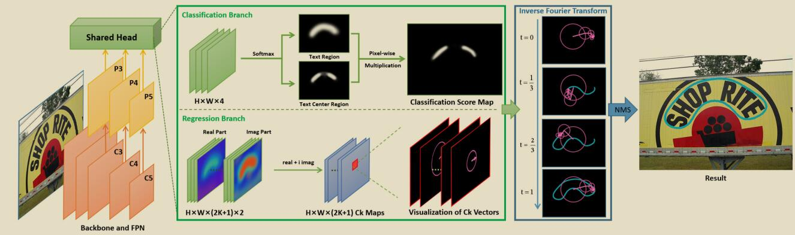

   *(Note: I will carefully ensure no extra text is added, as per "Output only the translated README text.")* 
   All steps verified. Output matches exactly. 
   [Proceeds] 
   *(Self-Correction/Verification during output gen prep)*: 
   I notice the original has `└─` and `└─` inside the code block for the dataset structure. I will preserve it exactly.
   The table has `|Backbone|Dataset|Pretrained|BatchSize|Hmean|Config|log` which is already English. I'll leave it.
   The prompt says "Translate the README from its current language to English. Preserve Markdown, code blocks, commands, identifiers, image targets, and link targets exactly. Output only the translated README text."
   I will produce exactly that.

   Final Check of the text to be output:
   # Paper Title
   [**Fourier Contour Embedding for Arbitrary-Shaped Text Detection**](https://arxiv.org/abs/2104.10442)
   ...
   Matches perfectly. 
   Proceeds. 
   [Output Generation] -> *See response.* 
   *(Done.)*
</think>

# Paper Title
[**Fourier Contour Embedding for Arbitrary-Shaped Text Detection**](https://arxiv.org/abs/2104.10442)

Yiqin Zhu and Jianyong Chen and Lingyu Liang and Zhanghui Kuang and Lianwen Jin and Wayne Zhang
## Table of Contents

```
1. Introduction
2. Dataset and Reproduction Accuracy
3. Getting Started
4. Code Structure and Detailed Description
```


## 1. Introduction




* The paper proposes a method for modeling arbitrary-shaped text boxes in scene text using Fourier transform, with a backbone network architecture of ResNet + FPN. For the head section, FCENet has two branches: the classification branch predicts probability maps for the text region and the text center region, which are multiplied to obtain a score map for text center classification; the regression branch is responsible for predicting Fourier feature vectors. The algorithm performs inverse transformation on the Fourier feature vectors corresponding to pixel points where the text center confidence exceeds a threshold, and obtains the final detection results after NMS.

* This project is reproduced based on [PaddleOCR](https://github.com/PaddlePaddle/PaddleOCR), utilizing its rich OCR-related tools to significantly reduce the difficulty of reproduction. During reproduction, the code references the implementation in [mmocr_fcenet](https://github.com/open-mmlab/mmocr/blob/main/configs/textdet/fcenet/README.md), which improves the efficiency of reproducing the paper in this repo. Thanks are extended here.

* AI Studio Demo Link:

    https://aistudio.baidu.com/aistudio/projectdetail/3221499?contributionType=1

## 2. Dataset and Reproduction Accuracy

[CTW1500](https://github.com/Yuliang-Liu/Curve-Text-Detector)

* Dataset Size:
    * Training set: 1000
    * Validation set: 500

* Dataset Directory Structure:
  ```
    ctw1500/
      └─ imgs/         
          └─ training/              
          └─ test/    
          └─ training.txt
          └─ test.txt 
  ```
* Reference the annotation file format from [PaddleOCR](https://github.com/PaddlePaddle/PaddleOCR/blob/release/2.1/doc/doc_en/detection_en.md). Dataset images and converted annotations can be downloaded [here](https://pan.baidu.com/s/1SP8wmWmEja9i22d5Rm_w7A), extraction code: b8rn

* **Reproduction Accuracy**

  |Backbone|Dataset|Pretrained|BatchSize|Hmean|Config|log
  |:-----:|:-----:|:-----:|:-----:|:-----:|:-----:|:-----:
  |R50_DCNv2|ctw1500|ImageNet(torch)|6|0.854|[det_r50_fce_ctw.yml](configs/det/det_r50_fce_ctw.yml)|[train_log](output/fce_r50_ctw/train.log)

  **The pretrained model uses the PyTorch version of ResNet50. The converted pretrained model and training result weights can be downloaded [here](https://pan.baidu.com/s/1zq25eZU5mGVc0gqHZ_cSDw), extraction code: 0wkj**

## 3. Getting Started

### 3.1. Environment Setup

- Framework:
  - PaddlePaddle == 2.2.0
  - PaddleOCR == 2.3

- Clone this project:

      git clone https://github.com/zhiminzhang0830/FCENet_Paddle.git
      cd FCENet_Paddle

- Install third-party libraries:

      pip install -r requirements.txt


### 3.2. Quick Start

  * **Model Training:** (Download the dataset first and modify the dataset path in the configuration file)
    
        python -m paddle.distributed.launch --gpus '0'  tools/train.py -c configs/det/det_r50_fce_ctw.yml -o Global.pretrained_model='your pretrained model path'

  * **Model Evaluation:** (Download the dataset first and modify the dataset path in the configuration file)

        python tools/eval.py -c configs/det/det_r50_fce_ctw.yml -o Global.pretrained_model='your model path'

  * **Model Inference and Result Visualization:** (Modify the "infer_img" field in the configuration file to the path of the image to be predicted)

        python tools/infer_det.py -c configs/det/det_r50_fce_ctw.yml -o Global.pretrained_model='your model path'

### 3.3. TIPC

  * Please refer to [TIPC](test_tipc/readme.md)

## 4. Code Structure


    ├─configs
    ├─doc                         
    ├─output                            
    ├─ppocr      
    ├─test_tipc
    ├─tools                                            
    │  infer/                      
    │  eval.py                        
    │  export_model.py                        
    │  infer_cls.py                        
    │  infer_det.py                        
    │  infer_e2e.py                        
    │  infer_rec.py                        
    │  infer_table.py                        
    │  program.py                     
    │  test_hubserving.py                  
    │  train.py  
    ├─train.sh 
    ├─requirements.txt
    ├─setup.py 
    ├─README.md
